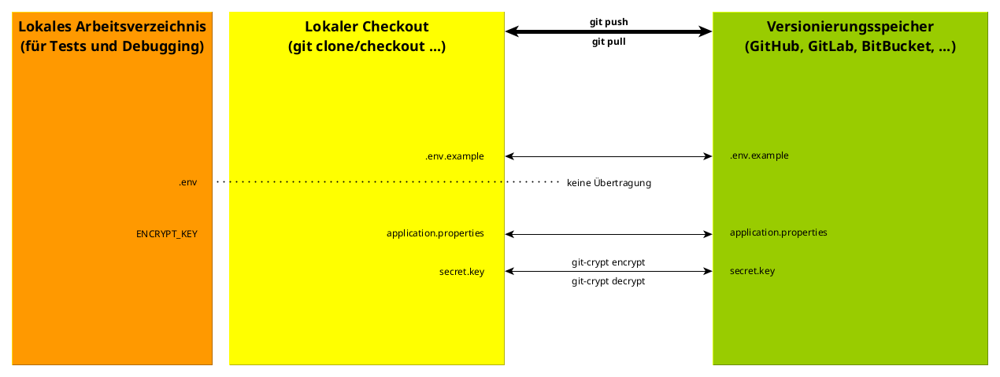
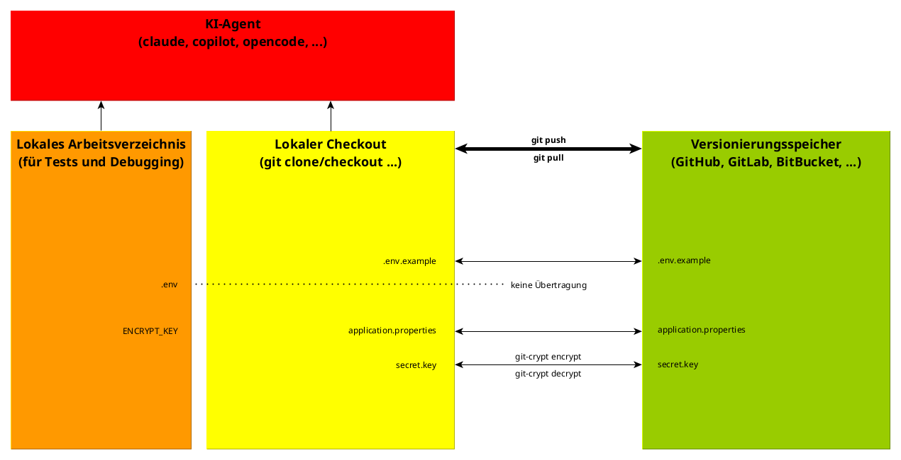
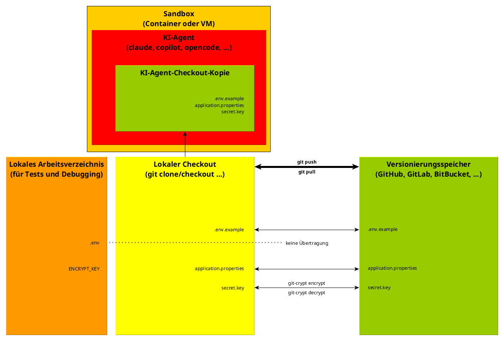

+++
date = '2026-11-24'
draft = false
title = 'Linux: Git-Projekte, KI und Geheimnisse'
categories = [ 'KI' ]
tags = [ 'ki', 'linux', 'ubuntu' ]
+++

<!--
Linux: Git-Projekte, KI und Geheimnisse
=======================================
-->

Auch wenn ich der künstlichen Intelligenz ein
wenig reserviert gegenüber stehe, so ist nicht von der
Hand zu weisen, dass sie bei vielen Arbeiten
hilfreich ist. Das schafft neue Herausforderungen
bei der Handhabung von Geheimnissen wie API-Keys,
Kennworte, usw.

<!--more-->

Software-Entwicklung mit Geheimnissen
-------------------------------------

Meine Arbeit als Entwicklungs- und
Infrastruktur-Berater erfolgt überwiegend mittels
GIT-Projekten - die Daten, die ich "erzeuge", landen
typischerweise in Versionierungsspeichern wie
GitHub, GitLab, BitBucket, Forgejo
oder ähnlichem - je nach Kundenwunsch.

Nachfolgend verwende ich GitHub  stellvertretend für
alle diese Versionierungsspeicher.

Klar: Wenn die GIT-Projekte mit Geheimnissen arbeiten,
dann dürfen diese Geheimnisse nicht in GitHub landen.
Dies ist eine Praxis, die seit Jahren etabliert ist
und meiner Erfahrung nach zumeist eingehalten wird.

Erreicht wird dies typischerweise mit Techniken wie:

- GIT-Speicherung von ".env.example" (enthält Beispiele der Geheimnisse
  und meist auch eine Anleitung, wie man die "richtigen" Geheimnisse einträgt),
  Arbeit mit ".env" (enthält die "richtigen" Geheimnisse und wird niemals eingecheckt)

- Verwendung von verschlüsselten Properties bei SpringBoot-Anwendungen
  (siehe [Spring Cloud Config - Encryption and Decryption](https://docs.spring.io/spring-cloud-config/reference/server/encryption-and-decryption.html)).

- GIT-Speicherung mittels "git-crypt" - dabei werden ganze Dateien
  verschlüsselt, bevor sie im Versionierungsspeicher abgelegt werden

Die Umgebung sieht dann so aus:

- In GitHub liegt eine Datei ".env.example", die
  keine realen Geheimnisse enthält
- Die Datei ".env" mit realen Geheimnissen liegt nur im lokalen Arbeitsverzeichnis
- In GitHub liegt eine Datei "application.properties" mit vielen Konfigurationsparametern.
  Die Werte der geheimen Parameter sind verschlüsselt
- Der zur Entschlüsselung notwendige ENCRYPT_KEY liegt nur im lokalen Arbeitsverzeichnis
  (oder steht anderweitig auf dem Arbeitsplatzrechner zur Verfügung)
- In GitHub liegt eine Datei "Uli_DEV.pem", die komplett verschlüsselt ist



### Beispiel ".env.example"

```
# GitLab Personal Access Token (api scope)
# Generate at: https://gitlab.heller.cool/-/user_settings/personal_access_tokens
GITLAB_PERSONAL_ACCESS_TOKEN=your-token-here
GITLAB_API_URL=https://gitlab.heller.cool/api/v4

# Jira Personal Access Token
# Generate at: https://jira.heller.cool/jira/secure/ViewProfile.jspa
JIRA_PERSONAL_TOKEN=your-token-here

# Confluence Personal Access Token
# Generate at: https://confluence.heller.cool/confluence/secure/ViewProfile.jspa
CONFLUENCE_PERSONAL_TOKEN=your-token-here
```

### Beispiel "application.properties"

```
database.user=mongodb-uli
database.password={cipher}23f269d24d7b32...143
```

### Beispiel "Uli_DEV.pem"

```
^@GITCRYPT^@<87><D1>...
(binärer Datenmüll)
```

Ergänzung um einen KI-Agenten
-----------------------------

Eine gängige Praxis ist die Erweiterung von vorigem Arbeitsablauf
um einen KI-Agenten:



Er wird entweder per Kommandozeile gestartet oder innerhalb der Entwicklungsumgebung.
Typischerweise hat er Zugriff auf das Arbeitsverzeichnis und damit "sieht" er auch
quasi alle Geheimnisse. Das ist aus verschiedenen Gründen potentiell ein Problem:

- Manche KI-Nutzungspläne nutzen alle verfügbaren Daten zur Erweiterung/zum Training der
  zugrunde liegenden KI-Modelle. Das bedeutet letztlich, dass die Geheimnisse
  in neueren Versionen des Modelles landen und damit potentiell anderen Nutzern
  zur Verfügung stehen können

- Auch ohne Training-Verwendung gibt es Berichte von Geheimnissen, die nach
  Übermittlung an eine KI-Infrastruktur "ausgenutzt" werden - siehe
  [arsTechnica - Researcher plants 2m canaries into the AI supply chain. A privacy disaster surfaced.](https://arstechnica.com/security/2026/11/a-leaky-ai-supply-chain-is-exposing-secret-user-data-at-an-alarming-rate/)
  und [dragos - Three breaches, endless leaks: Your AI supply chain needs canaries](https://www.dragos.com/blog/ai-supply-chain-security-canary-tokens#how-do-canary-tokens-detect-prompt-leaks)

Also: Geheimnisse und KI-Infrastruktur müssen strikt getrennt werden!

Zusätzlich gibt es auch ein Problem mit Umgebungsmodifikationen:
COPILOT führt bei der Ermittlung von Problemlösungen immer mal wieder
Kommandos in seiner Laufzeitumgebung aus. Bei der Nutzung im letzten Team
waren das sehr häufig kleine Python-Skripts, die üblicherweise vor der
Ausführung gesichtet und freigegeben werden müssen. Leider ist dies
oftmals sehr lästig, besonders, wenn man die Python-Skripts nicht
versteht. Dann ist es naheliegend, Python-Skript-Ausführung einfach
generell freizugeben, was im Endeffekt bedeutet, dass man quasi seinen
Benutzer für COPILOT frei gibt und später nicht mehr so richtig nachvollziehen
kann, welche Änderungen COPILOT durchgeführt hat.

Bei OPENCODE habe ich noch deutlich aggressiveres Verhalten beobachtet.
OPENCODE hat bei mir in einer Testumgebung ohne Rückfrage Zusatztools
installiert. Für die Problemlösung durchaus förderlich, für den Zustand
der Testumgebung eher nicht.

Also: Die übliche Laufzeitumgebung und der KI-Agent müssen strikt getrennt werden!

COPILOT hat einen eingebauten Trennmechanismus: Die Sandbox. Diese kann
man aktivieren und sie schottet dann den Agenten vom Restsystem ab.
Mir persönlich ist das zu unsicher. Für mich ist nicht klar, wie durchlässig
diese Abschottung ist und ob COPILOT sie nicht irgendwie deaktivieren oder
umgehen kann. Ich verwende lieber meine eigene Trennung - gerne auch zusätzlich
zur eingebauten Sandbox!

Konsequenzen aus fehlender Trennung
-----------------------------------

Angenommen, ich habe auf meinem Entwicklungsrechner einen KI-Agenten
gemäß obiger Beschreibung verwendet, dann würde ich persönlich diese
Aktionen für angebracht halten:

1. MUSS - Komplettsichtung des Rechners in Hinblick auf unerwünschte Änderungen
   - Pakete eingespielt/gelöscht
   - Konfigurationsanpassungen

2. MUSS - Ermittlung und Änderung aller Geheimnisse aus dem betreffenden Entwicklungsprojekt
   - Die Geheimnisse sind potentiell an die KI-Infrastruktur übergeben worden
     und damit nicht mehr vertrauenswürdig

3. OPTIONAL - Ermittlung und Änderung aller Geheimnisse auf meinem Entwicklungsrechner
   - OPENCODE "verlässt" teilweise den Projektordner und erlangt damit Zugriff
     auf "umgebende" Dateien
   - Damit sind auch "umgebende" Geheimnisse potentiell an die KI-Infrastruktur übergeben worden
     und nicht mehr vertrauenswürdig

4. EHER NICHT - Wenn ich im "Paranoid-Modus" bin, dann sperre ich auch alle lokal abliegenden SSH-Schlüssel
   - Ich verwende nicht-triviale Passphrases für meine SSH-Schlüssel
   - Die Schlüsseldateien könnten "entwischt" sein und dann mit "brute force"-Methoden geknackt werden
   - Ist eine sehr theoretische Mißbrauchsmöglichkeit, praktisch wohl eher irrelevant

5. EHER NICHT - Wenn ich im "Paranoid-Modus" bin, dann ändere ich auch alle Kennworte/Schlüssel, die in lokal
   vorhandenen Kennwortverwaltungen abliegen (bspw. KeePass, KeePassXC, Bitwarden, ...)
   - Die Kennwort-Datenbank könnte "entwischt" sein
   - Eine zugehörige Schlüsseldatei ebenso
   - Trotz nicht-trivialem Kennwort für die Kennwortverwaltung könnte diese mit "brute force"-Methoden geknackt werden
   - Ist eine sehr theoretische Mißbrauchsmöglichkeit, praktisch wohl eher irrelevant

6. EHER NICHT - Neuaufsetzen des Rechners
   - Die Komplettsichtung kann keine absolute Sicherheit geben - möglicherweise werden kritische Änderungen übersehen
   - Neuaufsetzen ist aufwändig

Die mit MUSS gekennzeichneten Aktionen würde ich persönlich auf jeden Fall durchführen,
die OPTIONAL-Aktion ziemlich wahrscheinlich und die EHER NICHT-Aktionen etwas
abhängig vom Einsatzzweck und von der Dauer der Nutzung.

KI-Agent mit Sandbox
--------------------

Ich persönlich verwende KI-Agenten ausschliesslich in einer Sandbox.
Der Ablauf ist grob so:

- Lokale Entwicklungsumgebung aufgesetzt wie üblich
- Leeren Container mit Internet-Zugriff erstellt
- KI-Agent im Container installiert
- Kopie des lokalen Checkouts im Container verfügbar gemacht

Der KI-Agent hat nun nur Zugriff auf die unkritischen
Quelltexte. Geheimnisse kennt er nicht.



Was klappt gut?

- KI-Agent kennt keine Geheimnisse
- KI-Agent hat keinen Zugriff auf meinen Arbeitsplatzrechner
- Umgebung für den KI-Agenten ist schnell aufgesetzt (weniger als 5 Minuten)
- Umgebung für den KI-Agenten kann schnell zurückgesetzt werden - mittels
  Container-Snapshot ist das eine Sache von wenigen Sekunden
- KI-Agent "kennt" den Quelltext des Entwicklungsprojektes und kann Verbesserungen vorschlagen
- KI-Agent "kennt" die Konfigurationsdateien von SpringBoot-Anwendungen und
  kann Verbesserungen vorschlagen (Geheimnisse in den Dateien sind verschlüsselt, Rest nicht)

Wo gibt es noch Verbesserungspotential?

- Ungefilterter Zugriff auf's Internet
- Kein Zugriff auf gesicherte Internet-Seiten
- (Fast) Kein Zugriff auf die Entwicklungsumgebung
- Konfigurationsdateien von Nicht-SpringBoot-Anwendungen sind problematisch. Sie sind
  entweder komplett verschlüsselt oder fehlen! Damit sind sie quasi unsichtbar für den KI-Agenten

Das Verbesserungspotential werde ich in Folgeartikeln heben!

Versionen
---------

- Getestet mit Ubuntu-2404

Links
-----

- [Spring Cloud Config - Encryption and Decryption](https://docs.spring.io/spring-cloud-config/reference/server/encryption-and-decryption.html)
- [arsTechnica - Researcher plants 2m canaries into the AI supply chain. A privacy disaster surfaced.](https://arstechnica.com/security/2026/11/a-leaky-ai-supply-chain-is-exposing-secret-user-data-at-an-alarming-rate/)
- [dragos - Three breaches, endless leaks: Your AI supply chain needs canaries](https://www.dragos.com/blog/ai-supply-chain-security-canary-tokens#how-do-canary-tokens-detect-prompt-leaks)

Historie
--------

- 2026-11-24: Erste Version
